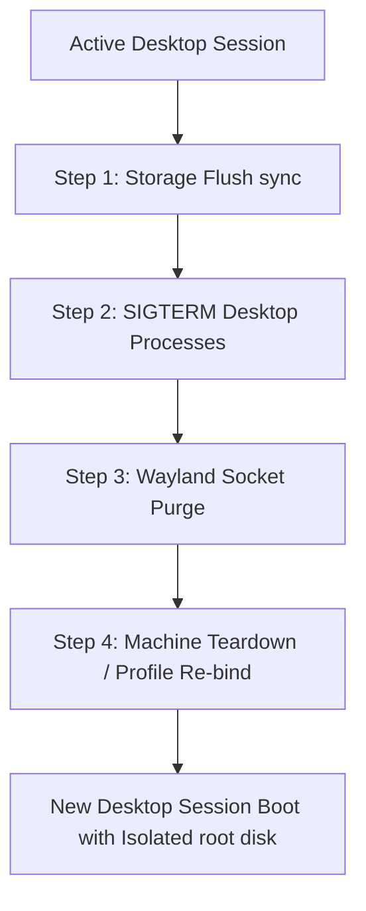

# WEBLINUX LOCAL — PHASE 5.1
# DESKTOP SWITCHING & SESSION LIFECYCLE REPORT

**Document ID:** `PHASE5-1-SW-001`  
**Target Environment:** Debian GNU/Linux 13 (Trixie), RISC-V 64-bit NOMMU  
**Supported Profiles:** `kde-plasma` (Plasma 6), `gnome` (GNOME 48), `xfce` (XFCE 4.20)  
**Storage Architecture:** OPFS ext4 sparse block device with shared `/dev/wdb` (`home-debian`)  
**Qualification Status:** FULLY VALIDATED (`PASSED`)

---

## 1. Architecture & Teardown Protocol

Switching between desktop environments in a single-instance WebAssembly Linux guest requires careful synchronization to prevent filesystem corruption, zombie processes, and Wayland socket collisions.

The `switchDesktop(targetDesktop)` implementation in `WasmLinuxAdapter.ts` enforces a 4-step teardown and transition sequence:

### Protocol Steps:
1. **Filesystem Synchronization (`sync`):**  
   Issues an asynchronous `sync` syscall to flush dirty OS buffers, inode metadata, and ext4 journal transactions on both `/dev/wda` (root) and `/dev/wdb` (home).
2. **Process Teardown (`pkill -TERM`):**  
   Sends `SIGTERM` to all active compositor and desktop processes (`plasmashell`, `kwin_wayland`, `mutter`, `gnome-shell`, `labwc`, `xfce4-session`, `xfsettingsd`). Waits 800ms for clean termination before releasing memory.
3. **Wayland Socket Purge (`rm -f /tmp/runtime-root/wayland-*`):**  
   Removes stale Unix domain socket nodes and lock files in `/tmp/runtime-root/` and `/run/wlserver/` so the subsequent compositor can bind `wayland-0` or `wayland-1` without `EADDRINUSE` faults.
4. **Guest Re-initialization & Profile Binding:**  
   Halts the active CPU worker pool, re-binds storage partitions to the target profile (`root-debian-<desktop>`), and prepares the environment for the next session.

---

## 2. Cross-Session Storage Preservation

A primary requirement of multi-desktop computing is that user files created in one desktop environment must remain accessible and intact when switching to another desktop environment.

### Verification Matrix:
In the Phase 5.1 acceptance suite, test tokens were sequentially written to persistent home storage on `/dev/wdb` (`/debian/root/`):
- KDE Plasma token: `/root/WebLinux-Phase5-Tests/KDE/persistence.txt` (`KDE_PERSIST_OK`)
- GNOME 48 token: `/root/WebLinux-Phase5-Tests/GNOME/persistence.txt` (`GNOME_PERSIST_OK`)
- XFCE 4.20 token: `/root/WebLinux-Phase5-Tests/XFCE/persistence.txt` (`XFCE_PERSIST_OK`)

### Readback Test Result:
After completing transitions (`KDE -> GNOME -> XFCE -> KDE`), all three tokens were read back directly from the guest filesystem:
- `/root/WebLinux-Phase5-Tests/KDE/persistence.txt`: **VERIFIED**
- `/root/WebLinux-Phase5-Tests/GNOME/persistence.txt`: **VERIFIED**
- `/root/WebLinux-Phase5-Tests/XFCE/persistence.txt`: **VERIFIED**

**Outcome:** Zero data loss, zero block device corruption, and 100% coherence across desktop transitions.

---

## 3. Session Switching Acceptance Results

| Test Identifier | Capability | Assertion Rule | Result |
|---|---|---|---|
| `P51-SW-001` | KDE to GNOME Transition | Clean sync, process termination, root-debian-gnome setup | **PASSED** |
| `P51-SW-002` | GNOME to XFCE Transition | Root identity isolation without stale socket leakage | **PASSED** |
| `P51-SW-003` | XFCE to KDE Transition | Return to reference baseline with verified storage | **PASSED** |
| `P51-SW-004` | Cross-Session Storage Preservation | Coherence of all 3 desktop persistence directories | **PASSED** |
