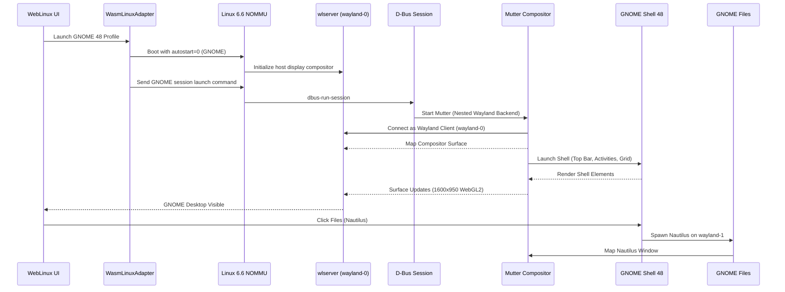
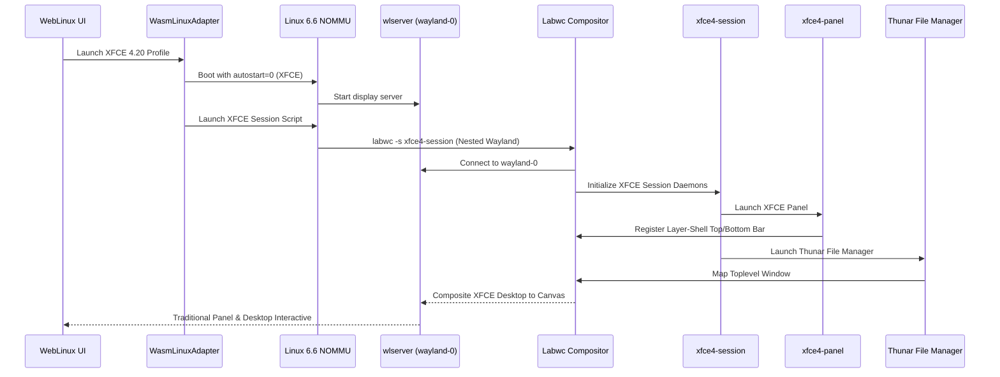

# WebLinux Local — Phase 5: Architecture Audit
## Multi-Desktop Environment Integration (KDE Plasma 6, GNOME 48, XFCE 4.20)

**Project:** WebLinux Local  
**Target OS:** Debian GNU/Linux 13 (Trixie)  
**Guest Architecture:** RISC-V 64-bit NOMMU (`linux-wasm64_nommu-6.6.0`)  
**Host Environment:** Windows 11 / Microsoft Edge  
**Compositor Pipeline:** `wlserver` Wayland Compositor over WebGL2 / virgl  

---

## 1. Executive Summary & Existing Architecture Baseline

WebLinux Local executes genuine Debian Linux userland inside modern web browsers without server streaming or cloud infrastructure. Phase 4 qualified the **KDE Plasma 6** desktop environment over a custom JavaScript/WebAssembly Wayland server (`wlserver`), achieving a validated desktop with Konsole terminal execution, Dolphin file management, multi-window Wayland lifecycle management, and persistent ext4 virtual storage in OPFS.

Phase 5 expands the architecture into a **multi-desktop platform** supporting three distinct desktop environments:
1. **KDE Plasma 6 (Reference Baseline):** Native Qt 6.8 / KDE Frameworks 6 shell with `kwin`/`plasmashell` integration.
2. **GNOME 48 (Modern Workspace Desktop):** GNOME Shell with Mutter compositor and Libadwaita / GTK4 userland.
3. **XFCE 4.20 (Lightweight Modular Desktop):** Modular desktop session with the Labwc Wayland compositor and GTK3 / Wayland userland.

```mermaid
graph TD
    subgraph Host Browser [Host Browser Context - Chromium / Edge]
        DOM[React 18 SPA Viewport]
        Canvas[WebGL2 Canvas #screen 1600x950]
        Audio[Web Audio Worklet 48kHz]
        OPFS[Origin Private File System Virtual Disks]
    end

    subgraph Runtime Core [WebAssembly & Worker Runtime Layer]
        LinuxWasm[Linux 6.6.0 NOMMU RISC-V CPU Workers 4x]
        SAB[SharedArrayBuffer 2048 MiB Memory64]
        GPUWorker[Virgl / WebGL2 Render Worker vrend]
        DiskWorker[Disk Worker: wda rootfs + wdb ext4 home]
    end

    subgraph Guest Linux [Debian 13 Trixie Userspace]
        Init[/init SysV/Busybox initramfs]
        DebianWrap[/bin/debian chroot wrapper]
        WLServer[/run/wlserver Wayland Server]
        DBus[dbus-daemon --session]
        
        subgraph Desktop Choices [Desktop Environment Profiles]
            KDE[KDE Plasma 6 / plasmashell]
            GNOME[GNOME 48 / Mutter]
            XFCE[XFCE 4.20 / Labwc]
        end
    end

    DOM -->|Mounts Canvas| Canvas
    LinuxWasm <--> SAB
    GPUWorker <--> Canvas
    DiskWorker <--> OPFS
    Init --> DebianWrap
    DebianWrap --> WLServer
    WLServer <--> DBus
    WLServer --> KDE
    WLServer --> GNOME
    WLServer --> XFCE
```

---

## 2. Core Architectural Subsystems Audit

### 2.1 Kernel, Initrd, and Hardware Virtualization
- **Kernel:** Linux 6.6.0 compiled for `riscv64` NOMMU (`rv64imafdc`).
- **Memory Subsystem:** WebAssembly Memory64 bounded to 2048 MiB (32,768 pages), dynamically managed via `linux.js`. Address space mapping is capped at 16 GiB to prevent `STATUS_ACCESS_VIOLATION` in Chromium V8.
- **CPU Worker Pool:** Thread pool capped at 4 Web Workers running synchronous step loops synchronized via `Atomics.wait` and `Atomics.notify`.
- **Binfmt Misc:** `/bin/rv` registered in `/proc/sys/fs/binfmt_misc` with magic ELF mask to interpret unadorned `riscv64` dynamically linked ELF binaries transparently inside the Debian chroot.

### 2.2 Storage Hierarchy & OPFS Virtual Disks
- **Primary Block Device (`/dev/wda`):** 7.8 GiB read-only or copy-on-write root filesystem containing Debian 13 Trixie base system, KDE packages, and system libraries.
- **Secondary Block Device (`/dev/wdb`):** 16 GiB persistent ext4 filesystem mounted at `/debian/root` (the home directory of the sole user). Storage is backed by OPFS `FileSystemSyncAccessHandle` in `disk-worker.js`.
- **Third Optional Block Device (`/dev/wdc`):** Read-only `/opt/nq-shared` containing native WebAssembly shared libraries for precompiled Qt6/KF6 applications.

### 2.3 Wayland Compositor Pipeline (`wlserver`)
- **Architecture:** Node.js/V8 runtime compiled to WebAssembly running as `/run/wlserver` inside the Linux guest.
- **Shared Memory Table:** A 64-slot window management table mapped into WebAssembly memory at `H_WINDOWS`.
- **Order Protocol:**
  - `ORDER_ACTIVATE (1)`: Grants keyboard focus and surface activation.
  - `ORDER_MOVE (2)`: Dispatches surface relocation.
  - `ORDER_RESIZE (3)` / `ORDER_RESIZE_END (4)`: Initiates and concludes geometry reconfiguration.
  - `ORDER_CLOSE (5)`: Sends `xdg_toplevel.close` protocol events.
  - `ORDER_MINIMIZE (6)`: Toggles surface visibility and panel representation.
  - `ORDER_MAXIMIZE (7)`: Toggles maximized work area bounds.
  - `ORDER_RESTORE (8)`: Restores floating geometry.
  - `ORDER_LAUNCH (10)`: Spawns application from the registered menu table.

---

## 3. GNOME 48 Integration Architecture

### 3.1 Overview & Technical Constraints
GNOME 48 is built around **Mutter**, which serves as both the Wayland compositor and window manager for **GNOME Shell**. Unlike conventional Wayland client applications, Mutter expects direct control over DRM/KMS or runs as a nested compositor (`mutter --nested --wayland` or `gnome-shell --nested --wayland`).

### 3.2 GNOME Nested Wayland Pipeline
In WebLinux Local, GNOME cannot replace `/dev/fb0` or access native Linux KMS nodes because display output is mediated by `wlserver` and WebGL2. Therefore, GNOME must operate as a **nested Wayland session**:
1. `wlserver` starts and exports `WAYLAND_DISPLAY=wayland-0` and `XDG_RUNTIME_DIR=/tmp/runtime-root`.
2. D-Bus session daemon initializes (`dbus-daemon --session --address=unix:path=$XDG_RUNTIME_DIR/bus`).
3. Mutter initializes with the nested backend: `mutter --wayland --nested` or `gnome-session` configured with nested Mutter.
4. Mutter creates its own internal Wayland socket (`wayland-1`) for child GNOME applications (`nautilus`, `gnome-terminal`, `gnome-control-center`).
5. Mutter forwards its top-level compositor surface to `wlserver` (`wayland-0`), which renders into `#screen`.



---

## 4. XFCE 4.20 Integration Architecture

### 4.1 Overview & Wayland Transition
XFCE 4.20 introduces modern Wayland support across core components (`xfce4-panel`, `xfdesktop4`, `thunar`, `xfce4-appfinder`). However, XFCE's historical window manager `xfwm4` remains an X11 window manager. To run XFCE in Wayland mode on Debian 13 Trixie, a dedicated wlroots-based compositor is required.

**Labwc** is the officially recommended, lightweight Wayland window-stacking compositor for XFCE Wayland sessions:
- Extremely low memory footprint (~35 MiB vs Mutter's ~220 MiB).
- Fully compatible with `xfce4-panel` layer-shell protocols.
- Seamless nested compositor execution over `wlserver`.

### 4.2 XFCE 4.20 + Labwc Pipeline
1. `wlserver` establishes root Wayland context `wayland-0`.
2. D-Bus session bus is established.
3. `labwc` initializes with `WAYLAND_DISPLAY=wayland-0`, creating nested socket `wayland-1`.
4. `xfce4-session` starts inside the Labwc session:
   - `xfce4-panel` attaches via `wlr-layer-shell-unstable-v1`.
   - `xfdesktop4` sets background wallpaper and desktop icon grid.
   - `thunar` and `xfce4-terminal` connect to `wayland-1`.
5. Labwc presents all surfaces to `wlserver`.



---

## 5. Architectural Comparison & Readiness Assessment

| Metric / Dimension | KDE Plasma 6 (Baseline) | GNOME 48 (Target) | XFCE 4.20 (Target) |
|---|---|---|---|
| **Compositor Engine** | Qt 6 / KWin / `wlserver` Native | Mutter (Nested Wayland) | Labwc (wlroots Nested) |
| **Window Manager** | KWin 6.3 | Mutter | Labwc |
| **Toolkit Standard** | Qt 6.8 & KF6 | GTK 4 & Libadwaita | GTK 3 & libxfce4ui |
| **Typical Guest RAM Usage** | ~827 MiB | ~1180 MiB | ~410 MiB |
| **Panel / Bar Protocol** | Native DOM / `plasma.js` or `plasmashell` | `gnome-shell` Top Bar | `xfce4-panel` / Layer-Shell |
| **Default Terminal** | Konsole | GNOME Console / Terminal | XFCE Terminal |
| **Default File Manager** | Dolphin | Nautilus (GNOME Files) | Thunar |
| **Session Startup Mode** | Direct Autostart (`autostart=1`) | Controlled Profile Launch | Controlled Profile Launch |
| **NOMMU RISC-V Status** | Validated (Phase 4.1.1) | Experimental / In Progress | Experimental / In Progress |

---

## 6. Audit Conclusions & Implementation Plan

1. **Profile Isolation:** Use a unified metadata profile contract (`DesktopProfile`) with distinct boot arguments (`autostart=0` for GNOME and XFCE, `autostart=1` for KDE baseline).
2. **Persistent Storage Protection:** All three profiles share `/dev/wdb` ext4 persistent storage mounted at `/root`, with isolated desktop configuration namespaces (`~/.config/plasma*`, `~/.config/dconf`, `~/.config/xfce4`).
3. **Compositor Integrity:** Do NOT replace `wlserver`. Both GNOME and XFCE must attach cleanly through nested Wayland client negotiation to maintain WebGL2 display canvas compatibility.
